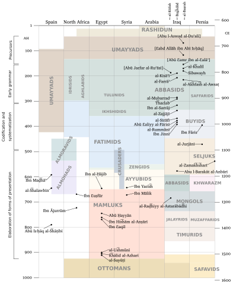
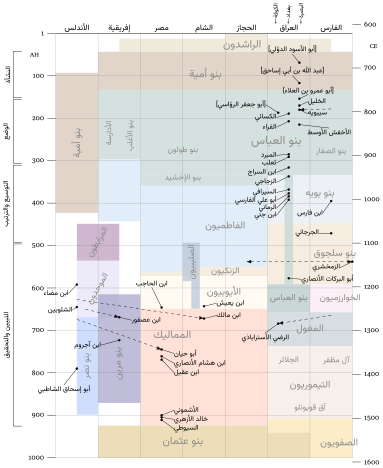

# Tikz chart of timeline of Arabic grammarians.

Inspired by and built upon Andreas Hallberg's work: <https://andreasmhallberg.github.io/timeline-of-arab-grammarians/>

## Building

### Required utilities

+ lualatex
+ pdftocairo (`brew install poppler`)

### Required fonts

+ Charis
+ Vazirmatn

### To build

Execute bash script `build.sh`

